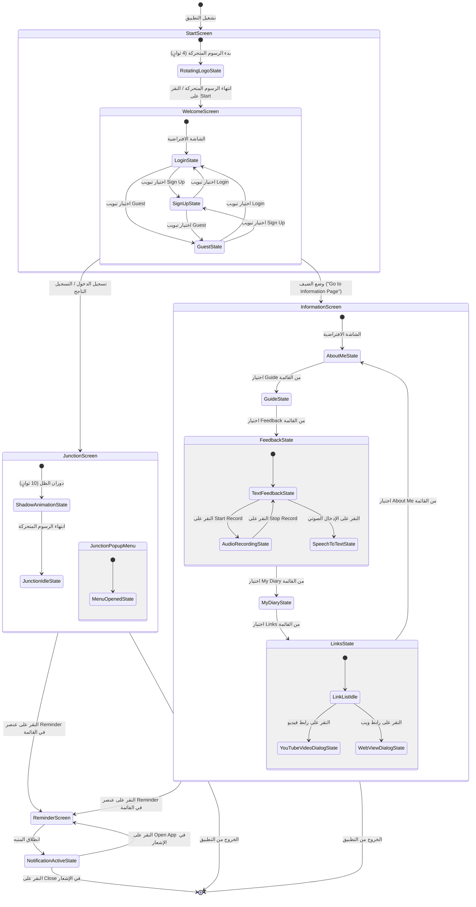

# 🧩 مخطط التنقل والحالات + خريطة الفئات والعلاقات
## مشروع أندرويد (Java): ZeFraStandart

يشرح هذا المستند التنقل بين الشاشات، وحالات التطبيق، ובنية الكود المصدري لتطبيق **ZeFraStandart** المكتوب بلغة Java.

---

## 1. المخطط 1: التنقل والحالات (Mermaid stateDiagram-v2)

يوضح هذا المخطط جميع الحالات المرئية للمستخدم والانتقالات بين شاشات التطبيق.



---

## 2. المخطط 2: خريطة الفئات والعلاقات (Mermaid flowchart TD)

يعرض هذا المخطط جميع فئات Java في المشروع مقسمة حسب الطبقات البرمجية.

```mermaid
flowchart TD
  classDef activity fill:#DBEAFE,stroke:#1E40AF,stroke-width:3px
  classDef fragment fill:#DCFCE7,stroke:#15803D,stroke-width:2px
  classDef dialog fill:#EDE9FE,stroke:#6D28D9,stroke-width:2px
  classDef model fill:#FEF9C3,stroke:#A16207,stroke-width:2px
  classDef data fill:#FCE7F3,stroke:#BE185D,stroke-width:2px
  classDef adapter fill:#FFEDD5,stroke:#C2410C,stroke-width:2px
  classDef helper fill:#F3F4F6,stroke:#6B7280,stroke-width:2px,stroke-dasharray:5 5
  classDef system fill:#E5E7EB,stroke:#9CA3AF,stroke-width:1px,stroke-dasharray:3 3

  subgraph LEGEND["دليل الرموز / Legend"]
    L_Activity["Activity<br/>[Activity]"]
    L_Fragment("Fragment<br/>[Fragment]")
    L_Dialog{"Dialog<br/>[Dialog]"}
    L_Model["Model<br/>[Model]"]
    L_Data[("Data<br/>[Data]")]
    L_Adapter[/"Adapter<br/>[Adapter]"/]
    L_Helper[["Helper<br/>[Helper]"]]
    L_System["System<br/>[System]"]
    class L_Activity activity
    class L_Fragment fragment
    class L_Dialog dialog
    class L_Model model
    class L_Data data
    class L_Adapter adapter
    class L_Helper helper
    class L_System system
  end

  subgraph UI["طبقة واجهة المستخدم: الشاشات"]
    Start["Start<br/>[Activity]"]
    Welcome["Welcome<br/>[Activity]"]
    Junction["Junction<br/>[Activity]"]
    Information["Information<br/>[Activity]"]
    Reminder["Reminder<br/>[Activity]"]

    LoginFragment("LoginFragment<br/>[Fragment]")
    SignUpFragment("SignUpFragment<br/>[Fragment]")
    GuestFragment("GuestFragment<br/>[Fragment]")
    AboutMeFragment("AboutMeFragment<br/>[Fragment]")
    GuideFragment("GuideFragment<br/>[Fragment]")
    FeedbackFragment("FeedbackFragment<br/>[Fragment]")
    MyDiaryFragment("MyDiaryFragment<br/>[Fragment]")
    LinksFragment("LinksFragment<br/>[Fragment]")

    CustomAlertDialog{"CustomAlertDialog<br/>[Dialog]"}
    CustomToolbar[["CustomToolbar<br/>[Helper]"]]

    class Start,Welcome,Junction,Information,Reminder activity
    class LoginFragment,SignUpFragment,GuestFragment,AboutMeFragment,GuideFragment,FeedbackFragment,MyDiaryFragment,LinksFragment fragment
    class CustomAlertDialog dialog
    class CustomToolbar helper
  end

  subgraph MODEL["طبقة النموذج: كائنات البيانات POJO"]
    User["User<br/>[Model]"]
    Link["Link<br/>[Model]"]
    class User,Link model
  end

  subgraph DATA["طبقة البيانات: قاعدة البيانات والتخزين"]
    HelperDB[("HelperDB<br/>[Data]")]
    class HelperDB data
  end

  subgraph HELPERS["الفئات المساعدة والخدمات والمستقبلات"]
    BaseMenu[["BaseMenu<br/>[Helper]"]]
    BaseMenuClass[["BaseMenuClass<br/>[Helper]"]]
    My_Toast[["My_Toast<br/>[Helper]"]]
    NotificationChannels[["NotificationChannels<br/>[Helper]"]]
    SimpleTextWatcher[["SimpleTextWatcher<br/>[Helper]"]]

    BatteryStatusReceiver[["BatteryStatusReceiver<br/>[Helper]"]]
    ChargerConnectionReceiver[["ChargerConnectionReceiver<br/>[Helper]"]]
    MobileNetworkReceiver[["MobileNetworkReceiver<br/>[Helper]"]]
    NetworkReceiver[["NetworkReceiver<br/>[Helper]"]]
    InternetConnectionReceiver[["InternetConnectionReceiver<br/>[Helper]"]]
    NotificationReceiver[["NotificationReceiver<br/>[Helper]"]]
    CloseNotificationService[["CloseNotificationService<br/>[Helper]"]]

    class BaseMenu,BaseMenuClass,My_Toast,NotificationChannels,SimpleTextWatcher helper
    class BatteryStatusReceiver,ChargerConnectionReceiver,MobileNetworkReceiver,NetworkReceiver,InternetConnectionReceiver,NotificationReceiver,CloseNotificationService helper
  end

  subgraph UNCONNECTED["بدون علاقات / للمراجعة"]
    BackupService[["BackupService<br/>[Helper]"]]
    InternetReceiver[["InternetReceiver<br/>[Helper]"]]
    class BackupService,InternetReceiver helper
  end

  %% علاقات التنقل (سهم متصل -->)
  Start -->|مؤقت 4 ثوانٍ / نقر bStart| Welcome
  Welcome -->|يعرض افتراضياً| LoginFragment
  Welcome -->|BottomNav nav_signup| SignUpFragment
  Welcome -->|BottomNav nav_guest| GuestFragment
  GuestFragment -->|نقر bGoToInformation| Information
  LoginFragment -->|نجاح تسجيل الدخول| Junction
  SignUpFragment -->|نجاح التسجيل| Junction

  Information -->|القائمة nav_about_me| AboutMeFragment
  Information -->|القائمة nav_guide| GuideFragment
  Information -->|القائمة nav_feedback| FeedbackFragment
  Information -->|القائمة nav_my_diary| MyDiaryFragment
  Information -->|القائمة nav_links| LinksFragment

  BaseMenu -->|نقر Reminder في القائمة| Reminder
  BaseMenuClass -->|نقر Reminder في القائمة| Reminder
  LinksFragment -->|نقر على عنصر رابط| CustomAlertDialog
  NotificationReceiver -->|نقر Open app| Reminder
  NotificationReceiver -->|نقر Close| CloseNotificationService

  %% علاقات الاستخدام (سهم منقط -..->)
  Start -.->|ينشئ القنوات| NotificationChannels
  Welcome -.->|يستخدم PopupMenu| BaseMenuClass
  Junction -.->|يستخدم PopupMenu| BaseMenuClass
  Information -.->|يسجل المستقبل| ChargerConnectionReceiver
  AboutMeFragment -.->|يراقب الشبكة| NetworkReceiver
  AboutMeFragment -.->|يراقب الشبكة الخلوية| MobileNetworkReceiver
  FeedbackFragment -.->|يراقب النص المدخل| SimpleTextWatcher
  LinksFragment -.->|يراقب الإنترنت| InternetConnectionReceiver
  BaseMenu -.->|يدير فحص البطارية| BatteryStatusReceiver
  BaseMenu -.->|يدير فحص الشاحن| ChargerConnectionReceiver
  BaseMenuClass -.->|يعرض Toast| My_Toast
  LoginFragment -.->|يعرض Toast| My_Toast
  SignUpFragment -.->|يعرض Toast| My_Toast
  LoginFragment -.->|إخراج صوتي| BaseMenuClass
  Reminder -.->|ينشئ القنوات| NotificationChannels
  NotificationReceiver -.->|يفحص القنوات| NotificationChannels

  %% علاقات البيانات (سهم عريض ==>)
  Start ==>|تهيئ قاعدة البيانات| HelperDB
  LoginFragment ==>|استعلام المستخدم| HelperDB
  LoginFragment ==>|ينشئ كائن| User
  SignUpFragment ==>|إدراج مستخدم| HelperDB
  SignUpFragment ==>|ينشئ كائن| User
  LinksFragment ==>|استعلام الروابط| HelperDB
  LinksFragment ==>|ينشئ قائمة| Link
  Reminder ==>|يجدول المنبه| NotificationReceiver
```



### جدول الدليل
| الرمز / السهم | النوع | الوصف / مثال من المشروع |
|---|---|---|
| `[ ]` (أزرق) | Activity | الشاشة الرئيسية في التطبيق (مثل `Start`, `Welcome`, `Junction`) |
| `( )` (أخضر) | Fragment | جزء واجهة قابل للإعادة (مثل `LoginFragment`, `GuideFragment`) |
| `{ }` (بنفسجي) | Dialog | نافذة حوارية منبثقة (مثل `CustomAlertDialog`) |
| `[ ]` (أصفر) | Model | كائن بيانات بدون تبعيات أندرويد (مثل `User`, `Link`) |
| `[( )]` (وردي) | Data | قاعدة بيانات / تخزين (مثل `HelperDB`) |
| `[/ /]` (برتقالي) | Adapter | محول بيانات القائمة (مثل `ArrayAdapter` في `LinksFragment`) |
| `[[ ]]` (رمادي) | Helper | فئة مساعدة أو مستقبل أو خدمة (مثل `BaseMenu`, `My_Toast`) |
| `[ ]` (رمادي فاتح) | System | فئة نظام أندرويد (مثل `Intent`, `AlarmManager`) |
| `-->` (متصل) | التنقل | انتقال بين الشاشات أو الأجزاء (مثل `Start --> Welcome`) |
| `-.->` (منقط) | استخدام / استدعاء | استدعاء دالة أو تسجيل مستقبل (مثل `Welcome -.-> BaseMenuClass`) |
| `==>` (عريض) | تدفق البيانات | قراءة أو كتابة أو إنشاء بيانات (مثل `LoginFragment ==> HelperDB`) |

---

## 4. شرح تفصيلي

### كيفية قراءة المخطط 1 (التنقل والحالات)

| العنصر في المخطط | ماذا يعني في هذا المشروع |
|---|---|
| `[*]` (دائرة البداية) | نقطة تشغيل التطبيق (`StartScreen`) |
| `[*]` (دائرة النهاية) | الخروج من التطبيق (من شاشة `Junction` أو `Information`) |
| مستطيل الحالة | الشاشة أو الحالة الفرعية المرئية للمستخدم |
| الإطار الخارجي المركب | الشاشة الأم التي تحتوي على أجزاء/حالات فرعية |
| سهم مع نص | انتقال ناتج عن حدث (مؤقت، نقر زر، عنصر قائمة) |

### كيفية قراءة المخطط 2 (خريطة الفئات)

| نوع الفئة | الشكل واللون | الوصف ومثال من ZeFraStandart |
|---|---|---|
| **Activity** | مستطيل `[ ]` أزرق | الشاشة الرئيسية. مثال: `Start`, `Welcome`, `Junction` |
| **Fragment** | دائرية `( )` أخضر | جزء مدمج في الشاشة. مثال: `LoginFragment`, `GuideFragment` |
| **Dialog** | معين `{ }` بنفسجي | نافذة حوارية. مثال: `CustomAlertDialog` |
| **Model** | مستطيل `[ ]` أصفر | نموذج بيانات POJO. مثال: `User`, `Link` |
| **Data** | أسطوانة `[( )]` وردي | قاعدة البيانات. مثال: `HelperDB` |
| **Adapter** | متوازي اضلاع `[/ /]` برتقالي | محول القائمة. مثال: `ArrayAdapter` في `LinksFragment` |
| **Helper** | برنامج فرعي `[[ ]]` رمادي | فئة مساعدة أو مستقبل أو خدمة. مثال: `BaseMenu` |
| **System** | مستطيل `[ ]` رمادي فاتح | فئة نظام أندرويد. مثال: `Intent`, `AlarmManager` |

---

### شرح بأسلوب بسيط

#### 1. الفكرة الرئيسية
في أي لحظة زمنية، يكون التطبيق في حالة واحدة محددة (شاشة أو نافذة حوارية مرئية). حدث الإدخال (نقر زر، انتهاء مؤقت) ينقل التطبيق إلى حالة جديدة.
> **للطلاب المتقدمين**: في علوم الحاسوب النظرية، يُسمى هذا السلوك **آلة الحالات المنتهية المحددة (DFA)**.

#### 2. تشبيه من الحياة اليومية
تخيل التطبيق مثل **آلة بيع المشروبات**:
- **حالة الانتظار**: تنتظر إدخال العملات.
- **حالة إدخال النقود**: تعاني الرصيد المتبقي.
- **حالة التوزيع**: تخرج المشروب بعد الضغط على الزر.

#### 3. الجزء 1 — تسلسل تشغيل التطبيق
1. **شاشة `Start`**: تشغل رسوماً متحركة لدوران الشعار لمدة 4 ثوانٍ.
2. **الانتقال**: بعد انتهاء 4 ثوانٍ (أو النقر على زر Start)، ينتقل إلى `Welcome`.
3. **شاشة `Welcome`**: الشاشة الحاوية مع شريط تنقل سفلي يعرض `LoginFragment` افتراضياً.

#### 4. الجزء 2 — الحياة الداخلية للشاشات الرئيسية
- **شاشة `Welcome`**:
  - `LoginFragment`: إدخال الاسم والكلمة السرية، والتحقق عبر `HelperDB`. عند التطابق ينقل إلى `Junction`.
  - `SignUpFragment`: إدخال بيانات المستخدم الجديد، وحفظه في `HelperDB` والانتقال إلى `Junction`.
  - `GuestFragment`: دخول كضيف، مع زر للانتقال إلى `Information`.
- **شاشة `Junction`**:
  - تشغل رسوماً متحركة لدوران ظل النص لمدة 10 ثوانٍ (`goShadow()`).
  - تحتوي على قائمة منبثقة عبر `BaseMenuClass`.
- **شاشة `Information`**:
  - تحتوي على قائمة جانبية (Drawer) تضم 5 أجزاء: `AboutMeFragment`, `GuideFragment`, `FeedbackFragment`, `MyDiaryFragment`, `LinksFragment`.
  - `FeedbackFragment`: ملاحظات نصية + تسجيل صوتي (`.3gp`) + تحويل الكلام إلى نص.
  - `GuideFragment`: يعرض 12 جزءاً من الدليل المقروء من ملف `part1`.
  - `LinksFragment`: يقرأ الروابط من `HelperDB` ويعرض فيديوهات/مواقع عبر `CustomAlertDialog`.
- **مراقبة البطارية والشبكة**:
  - `BatteryStatusReceiver`: يعرض Toast أحمر عند مستوى بطارية <= 15%.
  - `ChargerConnectionReceiver`: يحذر عند 15%، ويكرر التنبيه كل دقيقة عند 10%، ويغلق التطبيق عند 5%.

#### 5. الجزء 3 — الانتقالات العامة "من أي مكان"
- اختيار عنصر **Reminder** في القائمة يفتح شاشة `Reminder` من أي مكان.
- التنبيه المجدول عبر `AlarmManager` يفعل `NotificationReceiver` الذي ينشئ إشعاراً بزرين:
  - **Open app**: يفتح شاشة `Reminder`.
  - **Close**: يستدعي `CloseNotificationService` لإزالة الإشعار.

#### 6. الجزء 4 — خريطة الفئات والطبقات
- **طبقة UI**: تدير الواجهة (`Start`, `Welcome`, `Information` إلخ).
- **طبقة MODEL**: كائنات بيانات نقية (`User`, `Link`).
- **طبقة DATA**: `HelperDB` تدير جدولي `Users` و `Links` في SQLite.
- **طبقة HELPERS**:
  - `BaseMenu` و `BaseMenuClass`: إدارة القوائم المنبثقة وتحويل النص إلى كلام (TextToSpeech).
  - `My_Toast`: تنسيق رسائل Toast الملونة.
  - `Receivers`: مراقبة الشبكة والبطارية.

#### 7. الربط بالكود (أمثلة Java)

##### مثال أ: الانتقال بين الشاشات
```java
// في LoginFragment.java
Intent go = new Intent(getActivity(), Junction.class);
go.putExtra("user", user);
startActivity(go);
```

##### مثال ب: الاستعلام من قاعدة البيانات
```java
// في LoginFragment.java
db = helperDB.getReadableDatabase();
Cursor cursor = db.query(helperDB.TABLE_USER, null, null, null, null, null, null);
```

#### 8. لماذا نرسم مخططين؟
- **المخطط 1** يوضح **السلوك**: *ما يراه المستخدم ويفعله*.
- **Диаграмма 2** يوضح **البنية**: *كيف تمت هيكلة فئات الكود والعلاقات بينها*.

#### 9. أخطاء شائعة لدى الطلاب
- **أخطاء المخطط 1**:
  1. رسم `HelperDB` أو `My_Toast` كحالة شاشة (الفئات المساعدة ليست حالات!).
  2. نسيان سهم الخروج `--> [*]`.
- **أخطاء المخطط 2**:
  1. الخلط بين `Fragment` و `Activity`.
  2. نسيان فئات النموذج (`User`, `Link`).

---

## 5. أسئلة للتقييم الذاتي

1. **قيم من الكود**: كم ثانية تستغرق الرسوم المتحركة للشعار في `Start.java` قبل الانتقال التلقائي؟
   - *الجواب*: 4 ثوانٍ (4000 ميلي ثانية في `CountDownTimer`).
2. **المنطق والبطارية**: عند أي نسبة مئوية للبطارية يقوم `ChargerConnectionReceiver` بإغلاق التطبيق نهائياً (`System.exit(0)`)؟
   - *الجواب*: عند نسبة 5% من سعة البطارية.
3. **مسار المستخدم**: تتبع سلسلة الشاشات عند تسجيل مستخدم جديد.
   - *الجواب*: `StartScreen` --> `WelcomeScreen` (SignUpTab / `SignUpFragment`) --> `JunctionScreen`.
4. **"ماذا لو...؟"**: ماذا يحدث في `LinksFragment` إذا أرجعت قاعدة البيانات 0 سجلات من جدول `LINKS_TABLE`؟
   - *الجواب*: يظهر Toast أحمر `"Database of Links is empty"` وتبقى القائمة فارغة.
5. **مسؤولية الفئات**: ما هي الفئة المسؤولة عن إنشاء قنوات الإشعارات، وأين يتم استدعاؤها عند تشغيل التطبيق؟
   - *الجواب*: `NotificationChannels` وتُستدعى في `Start.java` داخل الدالة `onCreate`.
