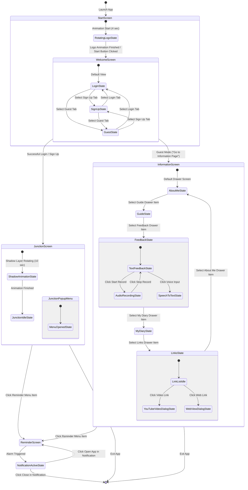

# 🧩 Navigation & State Diagram + Class Relationship Map
## Android Java Project: ZeFraStandart

This document explains the screen navigation, application states, and software architecture of the **ZeFraStandart** Android application written in Java.

---

## 1. Diagram 1: Navigation and States (Mermaid stateDiagram-v2)

This diagram shows all user-visible states and screen transitions across the application.



---

## 2. Diagram 2: Class Map & Relationships (Mermaid flowchart TD)

This diagram maps every Java class in the project, organized by architectural layers.

```mermaid
flowchart TD
  classDef activity fill:#DBEAFE,stroke:#1E40AF,stroke-width:3px
  classDef fragment fill:#DCFCE7,stroke:#15803D,stroke-width:2px
  classDef dialog fill:#EDE9FE,stroke:#6D28D9,stroke-width:2px
  classDef model fill:#FEF9C3,stroke:#A16207,stroke-width:2px
  classDef data fill:#FCE7F3,stroke:#BE185D,stroke-width:2px
  classDef adapter fill:#FFEDD5,stroke:#C2410C,stroke-width:2px
  classDef helper fill:#F3F4F6,stroke:#6B7280,stroke-width:2px,stroke-dasharray:5 5
  classDef system fill:#E5E7EB,stroke:#9CA3AF,stroke-width:1px,stroke-dasharray:3 3

  subgraph LEGEND["Legend / Symbols"]
    L_Activity["Activity<br/>[Activity]"]
    L_Fragment("Fragment<br/>[Fragment]")
    L_Dialog{"Dialog<br/>[Dialog]"}
    L_Model["Model<br/>[Model]"]
    L_Data[("Data<br/>[Data]")]
    L_Adapter[/"Adapter<br/>[Adapter]"/]
    L_Helper[["Helper<br/>[Helper]"]]
    L_System["System<br/>[System]"]
    class L_Activity activity
    class L_Fragment fragment
    class L_Dialog dialog
    class L_Model model
    class L_Data data
    class L_Adapter adapter
    class L_Helper helper
    class L_System system
  end

  subgraph UI["UI Layer: Screens & Views"]
    Start["Start<br/>[Activity]"]
    Welcome["Welcome<br/>[Activity]"]
    Junction["Junction<br/>[Activity]"]
    Information["Information<br/>[Activity]"]
    Reminder["Reminder<br/>[Activity]"]

    LoginFragment("LoginFragment<br/>[Fragment]")
    SignUpFragment("SignUpFragment<br/>[Fragment]")
    GuestFragment("GuestFragment<br/>[Fragment]")
    AboutMeFragment("AboutMeFragment<br/>[Fragment]")
    GuideFragment("GuideFragment<br/>[Fragment]")
    FeedbackFragment("FeedbackFragment<br/>[Fragment]")
    MyDiaryFragment("MyDiaryFragment<br/>[Fragment]")
    LinksFragment("LinksFragment<br/>[Fragment]")

    CustomAlertDialog{"CustomAlertDialog<br/>[Dialog]"}
    CustomToolbar[["CustomToolbar<br/>[Helper]"]]

    class Start,Welcome,Junction,Information,Reminder activity
    class LoginFragment,SignUpFragment,GuestFragment,AboutMeFragment,GuideFragment,FeedbackFragment,MyDiaryFragment,LinksFragment fragment
    class CustomAlertDialog dialog
    class CustomToolbar helper
  end

  subgraph MODEL["Model Layer: POJO Data Objects"]
    User["User<br/>[Model]"]
    Link["Link<br/>[Model]"]
    class User,Link model
  end

  subgraph DATA["Data Layer: Storage & DB"]
    HelperDB[("HelperDB<br/>[Data]")]
    class HelperDB data
  end

  subgraph HELPERS["Helpers, Receivers & Services"]
    BaseMenu[["BaseMenu<br/>[Helper]"]]
    BaseMenuClass[["BaseMenuClass<br/>[Helper]"]]
    My_Toast[["My_Toast<br/>[Helper]"]]
    NotificationChannels[["NotificationChannels<br/>[Helper]"]]
    SimpleTextWatcher[["SimpleTextWatcher<br/>[Helper]"]]

    BatteryStatusReceiver[["BatteryStatusReceiver<br/>[Helper]"]]
    ChargerConnectionReceiver[["ChargerConnectionReceiver<br/>[Helper]"]]
    MobileNetworkReceiver[["MobileNetworkReceiver<br/>[Helper]"]]
    NetworkReceiver[["NetworkReceiver<br/>[Helper]"]]
    InternetConnectionReceiver[["InternetConnectionReceiver<br/>[Helper]"]]
    NotificationReceiver[["NotificationReceiver<br/>[Helper]"]]
    CloseNotificationService[["CloseNotificationService<br/>[Helper]"]]

    class BaseMenu,BaseMenuClass,My_Toast,NotificationChannels,SimpleTextWatcher helper
    class BatteryStatusReceiver,ChargerConnectionReceiver,MobileNetworkReceiver,NetworkReceiver,InternetConnectionReceiver,NotificationReceiver,CloseNotificationService helper
  end

  subgraph UNCONNECTED["Disconnected / Stubs to Check"]
    BackupService[["BackupService<br/>[Helper]"]]
    InternetReceiver[["InternetReceiver<br/>[Helper]"]]
    class BackupService,InternetReceiver helper
  end

  %% Navigation Relationships (Solid Arrow -->)
  Start -->|4 sec timer / bStart click| Welcome
  Welcome -->|Embeds default| LoginFragment
  Welcome -->|BottomNav nav_signup| SignUpFragment
  Welcome -->|BottomNav nav_guest| GuestFragment
  GuestFragment -->|Click bGoToInformation| Information
  LoginFragment -->|Auth success| Junction
  SignUpFragment -->|Signup success| Junction

  Information -->|Drawer nav_about_me| AboutMeFragment
  Information -->|Drawer nav_guide| GuideFragment
  Information -->|Drawer nav_feedback| FeedbackFragment
  Information -->|Drawer nav_my_diary| MyDiaryFragment
  Information -->|Drawer nav_links| LinksFragment

  BaseMenu -->|Click Reminder menu| Reminder
  BaseMenuClass -->|Click Reminder menu| Reminder
  LinksFragment -->|Click Link item| CustomAlertDialog
  NotificationReceiver -->|Click Open app| Reminder
  NotificationReceiver -->|Click Close| CloseNotificationService

  %% Usage Relationships (Dotted Arrow -..->)
  Start -.->|Creates channels| NotificationChannels
  Welcome -.->|Uses PopupMenu| BaseMenuClass
  Junction -.->|Uses PopupMenu| BaseMenuClass
  Information -.->|Registers/Unregisters| ChargerConnectionReceiver
  AboutMeFragment -.->|Monitors Network| NetworkReceiver
  AboutMeFragment -.->|Monitors Cellular| MobileNetworkReceiver
  FeedbackFragment -.->|Monitors text input| SimpleTextWatcher
  LinksFragment -.->|Monitors internet| InternetConnectionReceiver
  BaseMenu -.->|Controls battery check| BatteryStatusReceiver
  BaseMenu -.->|Controls charger check| ChargerConnectionReceiver
  BaseMenuClass -.->|Shows Toast| My_Toast
  LoginFragment -.->|Shows Toast| My_Toast
  SignUpFragment -.->|Shows Toast| My_Toast
  LoginFragment -.->|Voice output| BaseMenuClass
  Reminder -.->|Creates channels| NotificationChannels
  NotificationReceiver -.->|Ensures channels| NotificationChannels

  %% Data Relationships (Thick Arrow ==>)
  Start ==>|Init DB| HelperDB
  LoginFragment ==>|Query user| HelperDB
  LoginFragment ==>|Creates instance| User
  SignUpFragment ==>|Insert user| HelperDB
  SignUpFragment ==>|Creates instance| User
  LinksFragment ==>|Query links| HelperDB
  LinksFragment ==>|Creates list| Link
  Reminder ==>|Schedules Alarm| NotificationReceiver
```



### Legend Table
| Symbol / Arrow | Type | Description / Example from Project |
|---|---|---|
| `[ ]` (Blue) | Activity | Core screen window (e.g., `Start`, `Welcome`, `Junction`, `Information`, `Reminder`) |
| `( )` (Green) | Fragment | Reusable UI section inside Activity (e.g., `LoginFragment`, `SignUpFragment`, `GuideFragment`) |
| `{ }` (Purple) | Dialog | Pop-up dialog window (e.g., `CustomAlertDialog`) |
| `[ ]` (Yellow) | Model | Object data container / POJO without Android dependencies (e.g., `User`, `Link`) |
| `[( )]` (Pink) | Data | Database / Storage helper (e.g., `HelperDB`) |
| `[/ /]` (Orange) | Adapter | List adapter bridging data to views (e.g., `ArrayAdapter` inside `LinksFragment`) |
| `[[ ]]` (Gray) | Helper | Utility class, Receiver, or Service (e.g., `BaseMenu`, `My_Toast`, `BatteryStatusReceiver`) |
| `[ ]` (Light Gray) | System | Android system framework class (e.g., `Intent`, `AlarmManager`, `NotificationManager`) |
| `-->` (Solid Arrow) | Navigation | Screen or fragment transition (e.g., `Start --> Welcome`) |
| `-.->` (Dotted Arrow) | Call / Uses | Invokes method, registers receiver, or uses utility (e.g., `Welcome -.-> BaseMenuClass`) |
| `==>` (Thick Arrow) | Data Flow | Reads, writes, creates, or queries data (e.g., `LoginFragment ==> HelperDB`) |

---

## 4. Detailed Explanation

### How to Read Diagram 1 (Navigation & States)

| Element in Diagram | What it Means in this Project |
|---|---|
| `[*]` (Start Circle) | App launch point (`StartScreen`) |
| `[*]` (End Circle) | App termination point (exiting from `Junction` or `Information` screen) |
| State Box (e.g., `StartScreen`) | Screen or sub-state currently visible to the user |
| Outer Composite Box | Parent screen containing nested sub-states (e.g., `InformationScreen` containing fragments) |
| Arrow with Label | Transition triggered by an event (e.g., timer finish, button click, menu item selection) |

### How to Read Diagram 2 (Class Map)

| Class Type | Shape & Color | Description & Example from ZeFraStandart |
|---|---|---|
| **Activity** | Rectangle `[ ]`, Blue | Main screen window. Example: `Start`, `Welcome`, `Junction` |
| **Fragment** | Rounded `( )`, Green | Embedded sub-screen. Example: `LoginFragment`, `GuideFragment` |
| **Dialog** | Diamond `{ }`, Purple | Modal pop-up window. Example: `CustomAlertDialog` |
| **Model** | Rectangle `[ ]`, Yellow | Data POJO class. Example: `User`, `Link` |
| **Data** | Cylinder `[( )]`, Pink | Database helper. Example: `HelperDB` |
| **Adapter** | Parallelogram `[/ /]`, Orange | List data adapter. Example: `ArrayAdapter` in `LinksFragment` |
| **Helper** | Subroutine `[[ ]]`, Gray | Utility, receiver, or service. Example: `BaseMenu`, `BatteryStatusReceiver` |
| **System** | Rectangle `[ ]`, Light Gray | System framework class. Example: `Intent`, `AlarmManager` |

---

### Simple Explanation

#### 1. Main Idea
At any given second, the application is in exactly one state (a specific screen or dialog visible to the user). An input event (button click, timer expiration, or system broadcast) moves the application into a new state.
> **Note for advanced students**: In Computer Science theory, this behavior is modeled as a **Deterministic Finite Automaton (DFA)** composed of states, input events, and state transitions.

#### 2. Real-Life Analogy
Think of the app like a **vending machine**:
- **Idle State**: Waiting for coins.
- **Coin Inserted State**: Displays current balance.
- **Selection State**: Dispenses item when button pressed.
- An event (inserting coin or pressing button) transitions the machine between exact states.

#### 3. Part 1 — Application Launch Flow
1. **`Start` Activity**: App opens with a rotating logo animation running for 4 seconds.
2. **Transition**: After 4 seconds (or clicking the Start button), `Start` navigates to `Welcome`.
3. **`Welcome` Activity**: Host screen containing a Bottom Navigation bar displaying `LoginFragment` by default.

#### 4. Part 2 — Internal Life of Main Screens
- **`Welcome` Screen**:
  - `LoginFragment`: User enters name and password. Checks DB via `HelperDB`. On match, navigates to `Junction`.
  - `SignUpFragment`: User enters details. Saves new `User` to `HelperDB` and navigates to `Junction`.
  - `GuestFragment`: Guest mode. User clicks "Go to information page" to navigate to `Information`.
- **`Junction` Screen**:
  - Plays a 10-second rotating shadow animation on a TextView (`goShadow()`).
  - Contains an `ImageView` (`ivPUMJ`) that triggers `BaseMenuClass` popup menu.
- **`Information` Screen**:
  - Contains a Navigation Drawer with 5 fragments: `AboutMeFragment`, `GuideFragment`, `FeedbackFragment`, `MyDiaryFragment`, `LinksFragment`.
  - `FeedbackFragment`: Text input + audio recording (`3gp` file) + Speech-to-Text.
  - `GuideFragment`: Displays 12 guide parts read asynchronously from raw file `part1`.
  - `LinksFragment`: Reads links from `HelperDB` and displays video or web dialogs via `CustomAlertDialog`.
- **Battery & Charger Monitoring**:
  - `BatteryStatusReceiver`: Shows custom red Toast when battery level drops to 15% or below.
  - `ChargerConnectionReceiver`: Shows low battery warning at 15%, repeat warning every minute at 10%, and exits app at 5%.

#### 5. Part 3 — "From Anywhere" Global Transitions
- Clicking the **Reminder** item in `BaseMenu` or `BaseMenuClass` opens `Reminder` activity from any screen with a menu.
- Triggering an alarm via `AlarmManager` calls `NotificationReceiver`, which builds a high-priority notification with two actions:
  - **Open app**: Opens `Reminder` screen.
  - **Close**: Calls `CloseNotificationService` to remove the notification.

#### 6. Part 4 — Class Map & Layers Explanation
- **UI Layer**: Handles user interaction (`Start`, `Welcome`, `Information`, `LoginFragment`, etc.).
- **MODEL Layer**: Pure data classes (`User`, `Link`). They hold no Android UI code.
- **DATA Layer**: `HelperDB` manages SQLite tables `Users` and `Links`.
- **HELPERS Layer**:
  - `BaseMenu` & `BaseMenuClass`: Encapsulate PopupMenu logic and TextToSpeech.
  - `My_Toast`: Formats custom colored Toast messages.
  - `Receivers`: Monitor network, battery, and charger status.
  - *What if removed?* If `HelperDB` is removed, authentication and links fail. If `Receivers` are removed, network and battery warnings stop working.

#### 7. Code Connections (Java Examples)

##### Example A: Screen Transition with Intent
```java
// In LoginFragment.java
Intent go = new Intent(getActivity(), Junction.class);
go.putExtra("user", user);
startActivity(go);
```

##### Example B: Helper Call & Database Query
```java
// In LoginFragment.java
db = helperDB.getReadableDatabase();
Cursor cursor = db.query(helperDB.TABLE_USER, null, null, null, null, null, null);
```

#### 8. Why Draw Two Diagrams?
- **Diagram 1 (State Diagram)** shows **behavior**: *what the user sees and does*.
- **Diagram 2 (Class Map)** shows **structure**: *how the code modules depend on each other*.

#### 9. Common Student Mistakes
- **Diagram 1 Mistakes**:
  1. Drawing `HelperDB` or `My_Toast` as a state (Helpers are NOT states!).
  2. Forgetting the exit transition `--> [*]`.
- **Diagram 2 Mistakes**:
  1. Conflating `Fragment` with `Activity` (using wrong shapes/colors).
  2. Forgetting to draw Model classes (`User`, `Link`).
  3. Drawing a system class as a central custom node.

---

## 5. Self-Check Questions

1. **Exact Code Values**: How many seconds does the logo animation run in `Start.java` before auto-navigating to `Welcome`?
   - *Answer*: 4 seconds (4000 ms in `CountDownTimer`).
2. **Logic & Battery Thresholds**: At what battery percentage does `ChargerConnectionReceiver` automatically exit the application (`System.exit(0)`)?
   - *Answer*: At 5% battery level.
3. **Scenario Route**: Trace the exact chain of screens a user travels when launching the app, clicking "Sign Up", filling details, and entering the app.
   - *Answer*: `StartScreen` --> `WelcomeScreen` (SignUpTab / `SignUpFragment`) --> `JunctionScreen`.
4. **"What if...?"**: What happens in `LinksFragment` if `HelperDB` returns 0 records when querying `LINKS_TABLE`?
   - *Answer*: A red custom Toast `"Database of Links is empty"` is shown, and no list items are displayed.
5. **Class Responsibilities**: Which class is responsible for creating Notification Channels, and which class calls it when the app launches?
   - *Answer*: `NotificationChannels` creates the channels, and `Start.java` calls `NotificationChannels.createNotificationChannels(context)` during `onCreate`.
