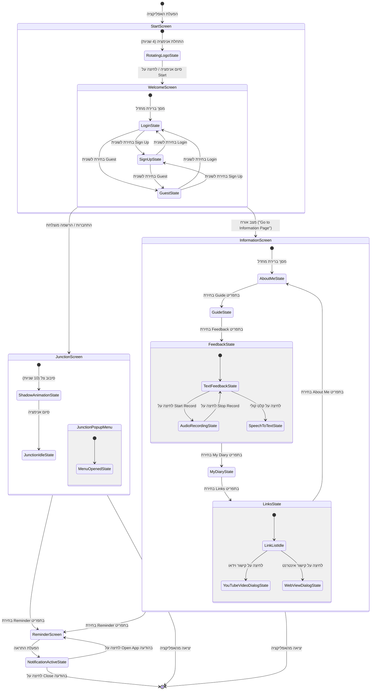

# 🧩 דיאגרמת ניווט ומצבים + מפת מחלקות וקשרים
## פרויקט אנדרואיד (Java): ZeFraStandart

מסמך זה מסביר את הניווט בין המסכים, מצבי האפליקציה ואת ארכיטקטורת הקוד של אפליקציית **ZeFraStandart** שנכתבה בשפת Java.

---

## 1. דיאגרמה 1: ניווט ומצבים (Mermaid stateDiagram-v2)

דיאגרמה זו מציגה את כל המצבים הגלויים למשתמש ואת המעברים בין מסכי האפליקציה.



---

## 2. דיאגרמה 2: מפת מחלקות וקשרים (Mermaid flowchart TD)

דיאגרמה זו מציגה את כל מחלקות ה-Java בפרויקט בחלוקה לשכבות ארכיטקטורה.

```mermaid
flowchart TD
  classDef activity fill:#DBEAFE,stroke:#1E40AF,stroke-width:3px
  classDef fragment fill:#DCFCE7,stroke:#15803D,stroke-width:2px
  classDef dialog fill:#EDE9FE,stroke:#6D28D9,stroke-width:2px
  classDef model fill:#FEF9C3,stroke:#A16207,stroke-width:2px
  classDef data fill:#FCE7F3,stroke:#BE185D,stroke-width:2px
  classDef adapter fill:#FFEDD5,stroke:#C2410C,stroke-width:2px
  classDef helper fill:#F3F4F6,stroke:#6B7280,stroke-width:2px,stroke-dasharray:5 5
  classDef system fill:#E5E7EB,stroke:#9CA3AF,stroke-width:1px,stroke-dasharray:3 3

  subgraph LEGEND["מקרא / סימונים"]
    L_Activity["Activity<br/>[Activity]"]
    L_Fragment("Fragment<br/>[Fragment]")
    L_Dialog{"Dialog<br/>[Dialog]"}
    L_Model["Model<br/>[Model]"]
    L_Data[("Data<br/>[Data]")]
    L_Adapter[/"Adapter<br/>[Adapter]"/]
    L_Helper[["Helper<br/>[Helper]"]]
    L_System["System<br/>[System]"]
    class L_Activity activity
    class L_Fragment fragment
    class L_Dialog dialog
    class L_Model model
    class L_Data data
    class L_Adapter adapter
    class L_Helper helper
    class L_System system
  end

  subgraph UI["שכבת UI: מסכים ותצוגות"]
    Start["Start<br/>[Activity]"]
    Welcome["Welcome<br/>[Activity]"]
    Junction["Junction<br/>[Activity]"]
    Information["Information<br/>[Activity]"]
    Reminder["Reminder<br/>[Activity]"]

    LoginFragment("LoginFragment<br/>[Fragment]")
    SignUpFragment("SignUpFragment<br/>[Fragment]")
    GuestFragment("GuestFragment<br/>[Fragment]")
    AboutMeFragment("AboutMeFragment<br/>[Fragment]")
    GuideFragment("GuideFragment<br/>[Fragment]")
    FeedbackFragment("FeedbackFragment<br/>[Fragment]")
    MyDiaryFragment("MyDiaryFragment<br/>[Fragment]")
    LinksFragment("LinksFragment<br/>[Fragment]")

    CustomAlertDialog{"CustomAlertDialog<br/>[Dialog]"}
    CustomToolbar[["CustomToolbar<br/>[Helper]"]]

    class Start,Welcome,Junction,Information,Reminder activity
    class LoginFragment,SignUpFragment,GuestFragment,AboutMeFragment,GuideFragment,FeedbackFragment,MyDiaryFragment,LinksFragment fragment
    class CustomAlertDialog dialog
    class CustomToolbar helper
  end

  subgraph MODEL["שכבת Model: אובייקטי נתונים POJO"]
    User["User<br/>[Model]"]
    Link["Link<br/>[Model]"]
    class User,Link model
  end

  subgraph DATA["שכבת Data: מסד נתונים ואחסון"]
    HelperDB[("HelperDB<br/>[Data]")]
    class HelperDB data
  end

  subgraph HELPERS["מחלקות עזר, מקבלים ושירותים"]
    BaseMenu[["BaseMenu<br/>[Helper]"]]
    BaseMenuClass[["BaseMenuClass<br/>[Helper]"]]
    My_Toast[["My_Toast<br/>[Helper]"]]
    NotificationChannels[["NotificationChannels<br/>[Helper]"]]
    SimpleTextWatcher[["SimpleTextWatcher<br/>[Helper]"]]

    BatteryStatusReceiver[["BatteryStatusReceiver<br/>[Helper]"]]
    ChargerConnectionReceiver[["ChargerConnectionReceiver<br/>[Helper]"]]
    MobileNetworkReceiver[["MobileNetworkReceiver<br/>[Helper]"]]
    NetworkReceiver[["NetworkReceiver<br/>[Helper]"]]
    InternetConnectionReceiver[["InternetConnectionReceiver<br/>[Helper]"]]
    NotificationReceiver[["NotificationReceiver<br/>[Helper]"]]
    CloseNotificationService[["CloseNotificationService<br/>[Helper]"]]

    class BaseMenu,BaseMenuClass,My_Toast,NotificationChannels,SimpleTextWatcher helper
    class BatteryStatusReceiver,ChargerConnectionReceiver,MobileNetworkReceiver,NetworkReceiver,InternetConnectionReceiver,NotificationReceiver,CloseNotificationService helper
  end

  subgraph UNCONNECTED["ללא קשרים / לבדוק"]
    BackupService[["BackupService<br/>[Helper]"]]
    InternetReceiver[["InternetReceiver<br/>[Helper]"]]
    class BackupService,InternetReceiver helper
  end

  %% קשרי ניווט (חץ מלא -->)
  Start -->|טיימר 4 שניות / בלחיצה| Welcome
  Welcome -->|מציג ברירת מחדל| LoginFragment
  Welcome -->|BottomNav nav_signup| SignUpFragment
  Welcome -->|BottomNav nav_guest| GuestFragment
  GuestFragment -->|לחיצה bGoToInformation| Information
  LoginFragment -->|התחברות מוצלחת| Junction
  SignUpFragment -->|הרשמה מוצלחת| Junction

  Information -->|תפריט nav_about_me| AboutMeFragment
  Information -->|תפריט nav_guide| GuideFragment
  Information -->|תפריט nav_feedback| FeedbackFragment
  Information -->|תפריט nav_my_diary| MyDiaryFragment
  Information -->|תפריט nav_links| LinksFragment

  BaseMenu -->|לחיצה על Reminder| Reminder
  BaseMenuClass -->|לחיצה על Reminder| Reminder
  LinksFragment -->|לחיצה על פריט קישור| CustomAlertDialog
  NotificationReceiver -->|לחיצה על Open app| Reminder
  NotificationReceiver -->|לחיצה על Close| CloseNotificationService

  %% קשרי שימוש (חץ מקווקו -..->)
  Start -.->|יוצר ערוצים| NotificationChannels
  Welcome -.->|משתמש ב-PopupMenu| BaseMenuClass
  Junction -.->|משתמש ב-PopupMenu| BaseMenuClass
  Information -.->|רשום למקבל| ChargerConnectionReceiver
  AboutMeFragment -.->|מנטר רשת| NetworkReceiver
  AboutMeFragment -.->|מנטר סלולר| MobileNetworkReceiver
  FeedbackFragment -.->|מנטר קלט טקסט| SimpleTextWatcher
  LinksFragment -.->|מנטר אינטרנט| InternetConnectionReceiver
  BaseMenu -.->|מנהל בדיקת סוללה| BatteryStatusReceiver
  BaseMenu -.->|מנהל בדיקת מטען| ChargerConnectionReceiver
  BaseMenuClass -.->|מציג Toast| My_Toast
  LoginFragment -.->|מציג Toast| My_Toast
  SignUpFragment -.->|מציג Toast| My_Toast
  LoginFragment -.->|פלט קולי| BaseMenuClass
  Reminder -.->|יוצר ערוצים| NotificationChannels
  NotificationReceiver -.->|בודק ערוצים| NotificationChannels

  %% קשרי נתונים (חץ מודגש ==>)
  Start ==>|אתחול DB| HelperDB
  LoginFragment ==>|שאילתת משתמש| HelperDB
  LoginFragment ==>|יוצר אובייקט| User
  SignUpFragment ==>|הכנסת משתמש| HelperDB
  SignUpFragment ==>|יוצר אובייקט| User
  LinksFragment ==>|שאילתת קישורים| HelperDB
  LinksFragment ==>|יוצר רשימת| Link
  Reminder ==>|מתזמן התראה| NotificationReceiver
```



### טבלת מקרא
| סמל / חץ | סוג | תיאור / דוגמה מהפרויקט |
|---|---|---|
| `[ ]` (כחול) | Activity | מסך ראשי באפליקציה (למשל `Start`, `Welcome`, `Junction`) |
| `( )` (ירוק) | Fragment | חלק מתוכן המסך (למשל `LoginFragment`, `GuideFragment`) |
| `{ }` (סגול) | Dialog | חלון דיאלוג קופץ (למשל `CustomAlertDialog`) |
| `[ ]` (צהוב) | Model | אובייקט נתונים ללא תלויות אנדרואיד (למשל `User`, `Link`) |
| `[( )]` (ורוד) | Data | מסד נתונים / אחסון (למשל `HelperDB`) |
| `[/ /]` (כתום) | Adapter | מתאם נתונים לרשימה (למשל `ArrayAdapter` ב-`LinksFragment`) |
| `[[ ]]` (אפור) | Helper | מחלקת עזר, מקבל או שירות (למשל `BaseMenu`, `My_Toast`) |
| `[ ]` (אפור-בהיר) | System | מחלקת מערכת של אנדרואיד (למשל `Intent`, `AlarmManager`) |
| `-->` (מלא) | ניווט | מעבר בין מסכים או פרגמנטים (למשל `Start --> Welcome`) |
| `-.->` (מקווקו) | שימוש / קריאה | קריאה למתודה או שימוש ברכיב (למשל `Welcome -.-> BaseMenuClass`) |
| `==>` (מודגש) | זרימת נתונים | קריאה, כתיבה, יצירה או שאילתה (למשל `LoginFragment ==> HelperDB`) |

---

## 4. הסבר מפורט

### איך לקרוא את דיאגרמה 1 (ניווט ומצבים)

| אלמנט בדיאגרמה | מה זה אומר בפרויקט הזה |
|---|---|
| `[*]` (עיגול התחלה) | נקודת ההפעלה של האפליקציה (`StartScreen`) |
| `[*]` (עיגול סיום) | יציאה מהאפליקציה (מהמסך `Junction` או `Information`) |
| מלבן מצב | מסך או מצב פנימי המוצג למשתמש |
| מסגרת חיצונית מורכבת | מסך אב המכיל מצבים/פרגמנטים פנימיים |
| חץ עם כיתוב | מעבר שמופעל על ידי אירוע (טיימר, לחיצה על כפתור, פריט תפריט) |

### איך לקרוא את דיאגרמה 2 (מפת מחלקות)

| סוג מחלקה | צורה וצבע | תיאור ודוגמה מ-ZeFraStandart |
|---|---|---|
| **Activity** | מלבן `[ ]`, כחול | מסך ראשי. דוגמה: `Start`, `Welcome`, `Junction` |
| **Fragment** | מעוגל `( )`, ירוק | פרגמנט מוטמע. דוגמה: `LoginFragment`, `GuideFragment` |
| **Dialog** | מעוין `{ }`, סגול | חלון דיאלוג. דוגמה: `CustomAlertDialog` |
| **Model** | מלבן `[ ]`, צהוב | מודל נתונים POJO. דוגמה: `User`, `Link` |
| **Data** | צילינדר `[( )]`, ורוד | מסד נתונים. דוגמה: `HelperDB` |
| **Adapter** | מקבילית `[/ /]`, כתום | מתאם רשימה. דוגמה: `ArrayAdapter` ב-`LinksFragment` |
| **Helper** | תת-תוכנית `[[ ]]`, אפור | מחלקת עזר, מקבל או שירות. דוגמה: `BaseMenu` |
| **System** | מלבן `[ ]`, אפור-בהיר | מחלקת מערכת. דוגמה: `Intent`, `AlarmManager` |

---

### הסבר בלשון פשוטה

#### 1. הרעיון המרכזי
בכל רגע נתון האפליקציה נמצאת בדיוק במצב אחד (מסך או דיאלוג ספציפי). אירוע קלט (לחיצת כפתור, סיום טיימר) מעביר אותה למצב חדש.
> **לתלמידים מתקדמים**: במדעי המחשב התיאורטיים התנהגות זו מיוצגת על ידי **אוטומט סופי דטרמיניסטי (DFA)**.

#### 2. אנלוגיה יומיומית
חשבו על האפליקציה כמו **מכונת משקאות**:
- **מצב המתנה**: מחכה למטבעות.
- **מצב כסף שהוכנס**: מציג את היתרה.
- **מצב חלוקה**: מוציא משקה לאחר לחיצה על כפתור.

#### 3. חלק 1 — סדר הפעלת האפליקציה
1. **מסך `Start`**: מפעיל אנימציית סיבוב של הלוגו במשך 4 שניות.
2. **מעבר**: בתום 4 שניות (או בלחיצה על כפתור Start) עוברים למסך `Welcome`.
3. **מסך `Welcome`**: מסך אב עם סרגל ניווט תחתון, המציג כברירת מחדל את `LoginFragment`.

#### 4. חלק 2 — החיים הפנימיים של המסכים הראשיים
- **מסך `Welcome`**:
  - `LoginFragment`: הזנת שם וסיסמה, בדיקה ב-`HelperDB`. אם תואם — מעבר ל-`Junction`.
  - `SignUpFragment`: הזנת פרטים, שמירת משתמש ב-`HelperDB` ומעבר ל-`Junction`.
  - `GuestFragment`: כניסת אורח, כפתור מעבר ל-`Information`.
- **מסך `Junction`**:
  - מפעיל אנימציית צל מסתובב במשך 10 שניות (`goShadow()`).
  - מכיל תפריט קופץ דרך `BaseMenuClass`.
- **מסך `Information`**:
  - מכיל תפריט צדדי (Drawer) עם 5 פרגמנטים: `AboutMeFragment`, `GuideFragment`, `FeedbackFragment`, `MyDiaryFragment`, `LinksFragment`.
  - `FeedbackFragment`: משוב טקסט + הקלטת שמע (`.3gp`) + זיהוי דיבור.
  - `GuideFragment`: מציג 12 חלקי מדריך מתוך הקובץ `part1`.
  - `LinksFragment`: קורא מ-`HelperDB` מציג דיאלוג וידאו/אינטרנט דרך `CustomAlertDialog`.
- **ניטור סוללה ורשת**:
  - `BatteryStatusReceiver`: מציג Toast אדום כשהסוללה <= 15%.
  - `ChargerConnectionReceiver`: מזהיר ב-15%, כל דקה ב-10%, וסוגר את האפליקציה ב-5%.

#### 5. חלק 3 — מעברים גלובליים "מכל מקום"
- בחירת **Reminder** בתפריט תפתח את המסך `Reminder` מכל מקום.
- התראה שתוזמנה דרך `AlarmManager` תפעיל את `NotificationReceiver`, המציג הודעה עם שתי פעולות:
  - **Open app**: פותח את המסך `Reminder`.
  - **Close**: מפעיל את `CloseNotificationService` להסרת ההודעה.

#### 6. חלק 4 — מפת מחלקות ושכבות
- **שכבת UI**: מנהלת את ממשק המשתמש (`Start`, `Welcome`, `Information` וכו').
- **שכבת MODEL**: אובייקטי נתונים נקיים (`User`, `Link`).
- **שכבת DATA**: `HelperDB` מנהלת את טבלאות `Users` ו-`Links` ב-SQLite.
- **שכבת HELPERS**:
  - `BaseMenu` ו-`BaseMenuClass`: ניהול תפריטים קופצים וטקסט לדיבור (TextToSpeech).
  - `My_Toast`: עיצוב הודעות Toast מותאמות אישית.
  - `Receivers`: מעקב אחר רשת וסוללה.

#### 7. קשר לקוד (דוגמאות Java)

##### דוגמה א': מעבר בין מסכים
```java
// בתוך LoginFragment.java
Intent go = new Intent(getActivity(), Junction.class);
go.putExtra("user", user);
startActivity(go);
```

##### דוגמה ב': שאילתה למסד נתונים
```java
// בתוך LoginFragment.java
db = helperDB.getReadableDatabase();
Cursor cursor = db.query(helperDB.TABLE_USER, null, null, null, null, null, null);
```

#### 8. למה לשרטט שתי דיאגרמות?
- **דיאגרמה 1** מציגה **התנהגות**: *מה המשתמש רואה ועושה*.
- **דיאגרמה 2** מציגה **מבנה**: *איך בנויות מחלקות הקוד והקשרים ביניהן*.

#### 9. טעויות נפוצות של תלמידים
- **טעויות בדיאגרמה 1**:
  1. שרטוט `HelperDB` או `My_Toast` כמצב מסך (מחלקות עזר אינן מצבים!).
  2. שכחת מעבר יציאה `--> [*]`.
- **טעויות בדיאגרמה 2**:
  1. בלבול בין `Fragment` ל-`Activity`.
  2. שכחת מחלקות המודל (`User`, `Link`).

---

## 5. שאלות לבדיקה עצמית

1. **ערכים מתוך הקוד**: כמה שניות נמשכת אנימציית הלוגו ב-`Start.java` עד למעבר האוטומטי?
   - *תשובה*: 4 שניות (4000 מילי-שניות ב-`CountDownTimer`).
2. **לוגיקה וסוללה**: באיזה אחוז סוללה `ChargerConnectionReceiver` סוגר את האפליקציה (`System.exit(0)`)?
   - *תשובה*: ב-5% סוללה.
3. **מסלול המשתמש**: תאר את שרשרת המסכים ברישום משתמש חדש.
   - *תשובה*: `StartScreen` --> `WelcomeScreen` (SignUpTab / `SignUpFragment`) --> `JunctionScreen`.
4. **"מה יקרה אם...?"**: מה יקרה ב-`LinksFragment` אם בטבלה `LINKS_TABLE` ב-DB יש 0 רשומות?
   - *תשובה*: יוצג Toast אדום `"Database of Links is empty"`, והרשימה תישאר ריקה.
5. **אחריות מחלקות**: איזו מחלקה אחראית על יצירת ערוצי ההתראות, ואיפה היא נקראת עם הפעלת האפליקציה?
   - *תשובה*: `NotificationChannels`, והיא נקראת ב-`Start.java` במתודה `onCreate`.
