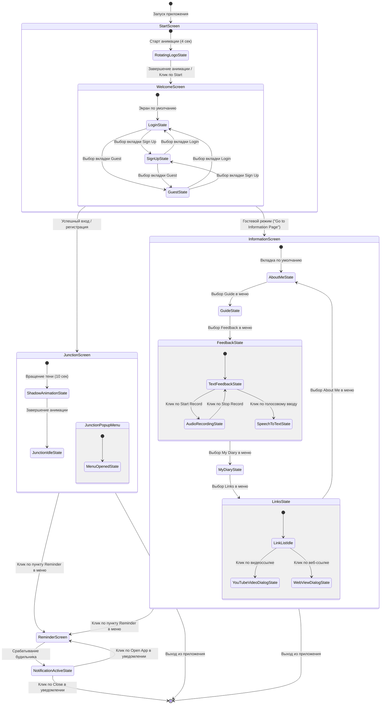

# 🧩 Диаграмма навигации и состояний + Карта классов и связей
## Проект Android (Java): ZeFraStandart

Этот документ объясняет навигацию по экранам, состояния приложения и архитектуру исходного кода приложения **ZeFraStandart**, написанного на языке Java.

---

## 1. Диаграмма 1: Навигация и состояния (Mermaid stateDiagram-v2)

Диаграмма показывает все состояния, видимые пользователю, и переходы между экранами приложения.



---

## 2. Диаграмма 2: Карта классов и связей (Mermaid flowchart TD)

Диаграмма отображает все Java-классы проекта, разделенные по архитектурным слоям.

```mermaid
flowchart TD
  classDef activity fill:#DBEAFE,stroke:#1E40AF,stroke-width:3px
  classDef fragment fill:#DCFCE7,stroke:#15803D,stroke-width:2px
  classDef dialog fill:#EDE9FE,stroke:#6D28D9,stroke-width:2px
  classDef model fill:#FEF9C3,stroke:#A16207,stroke-width:2px
  classDef data fill:#FCE7F3,stroke:#BE185D,stroke-width:2px
  classDef adapter fill:#FFEDD5,stroke:#C2410C,stroke-width:2px
  classDef helper fill:#F3F4F6,stroke:#6B7280,stroke-width:2px,stroke-dasharray:5 5
  classDef system fill:#E5E7EB,stroke:#9CA3AF,stroke-width:1px,stroke-dasharray:3 3

  subgraph LEGEND["Обозначения / Легенда"]
    L_Activity["Activity<br/>[Activity]"]
    L_Fragment("Fragment<br/>[Fragment]")
    L_Dialog{"Dialog<br/>[Dialog]"}
    L_Model["Model<br/>[Model]"]
    L_Data[("Data<br/>[Data]")]
    L_Adapter[/"Adapter<br/>[Adapter]"/]
    L_Helper[["Helper<br/>[Helper]"]]
    L_System["System<br/>[System]"]
    class L_Activity activity
    class L_Fragment fragment
    class L_Dialog dialog
    class L_Model model
    class L_Data data
    class L_Adapter adapter
    class L_Helper helper
    class L_System system
  end

  subgraph UI["Слой UI: Экраны и представления"]
    Start["Start<br/>[Activity]"]
    Welcome["Welcome<br/>[Activity]"]
    Junction["Junction<br/>[Activity]"]
    Information["Information<br/>[Activity]"]
    Reminder["Reminder<br/>[Activity]"]

    LoginFragment("LoginFragment<br/>[Fragment]")
    SignUpFragment("SignUpFragment<br/>[Fragment]")
    GuestFragment("GuestFragment<br/>[Fragment]")
    AboutMeFragment("AboutMeFragment<br/>[Fragment]")
    GuideFragment("GuideFragment<br/>[Fragment]")
    FeedbackFragment("FeedbackFragment<br/>[Fragment]")
    MyDiaryFragment("MyDiaryFragment<br/>[Fragment]")
    LinksFragment("LinksFragment<br/>[Fragment]")

    CustomAlertDialog{"CustomAlertDialog<br/>[Dialog]"}
    CustomToolbar[["CustomToolbar<br/>[Helper]"]]

    class Start,Welcome,Junction,Information,Reminder activity
    class LoginFragment,SignUpFragment,GuestFragment,AboutMeFragment,GuideFragment,FeedbackFragment,MyDiaryFragment,LinksFragment fragment
    class CustomAlertDialog dialog
    class CustomToolbar helper
  end

  subgraph MODEL["Слой Model: Объекты данных POJO"]
    User["User<br/>[Model]"]
    Link["Link<br/>[Model]"]
    class User,Link model
  end

  subgraph DATA["Слой Data: Хранилище и БД"]
    HelperDB[("HelperDB<br/>[Data]")]
    class HelperDB data
  end

  subgraph HELPERS["Вспомогательные классы, приемники и сервисы"]
    BaseMenu[["BaseMenu<br/>[Helper]"]]
    BaseMenuClass[["BaseMenuClass<br/>[Helper]"]]
    My_Toast[["My_Toast<br/>[Helper]"]]
    NotificationChannels[["NotificationChannels<br/>[Helper]"]]
    SimpleTextWatcher[["SimpleTextWatcher<br/>[Helper]"]]

    BatteryStatusReceiver[["BatteryStatusReceiver<br/>[Helper]"]]
    ChargerConnectionReceiver[["ChargerConnectionReceiver<br/>[Helper]"]]
    MobileNetworkReceiver[["MobileNetworkReceiver<br/>[Helper]"]]
    NetworkReceiver[["NetworkReceiver<br/>[Helper]"]]
    InternetConnectionReceiver[["InternetConnectionReceiver<br/>[Helper]"]]
    NotificationReceiver[["NotificationReceiver<br/>[Helper]"]]
    CloseNotificationService[["CloseNotificationService<br/>[Helper]"]]

    class BaseMenu,BaseMenuClass,My_Toast,NotificationChannels,SimpleTextWatcher helper
    class BatteryStatusReceiver,ChargerConnectionReceiver,MobileNetworkReceiver,NetworkReceiver,InternetConnectionReceiver,NotificationReceiver,CloseNotificationService helper
  end

  subgraph UNCONNECTED["Без связей / На проверку"]
    BackupService[["BackupService<br/>[Helper]"]]
    InternetReceiver[["InternetReceiver<br/>[Helper]"]]
    class BackupService,InternetReceiver helper
  end

  %% Связи навигации (Сплошная стрелка -->)
  Start -->|Таймер 4 сек / клик bStart| Welcome
  Welcome -->|Встраивает по умолчанию| LoginFragment
  Welcome -->|BottomNav nav_signup| SignUpFragment
  Welcome -->|BottomNav nav_guest| GuestFragment
  GuestFragment -->|Клик bGoToInformation| Information
  LoginFragment -->|Успешная авторизация| Junction
  SignUpFragment -->|Успешная регистрация| Junction

  Information -->|Шторка nav_about_me| AboutMeFragment
  Information -->|Шторка nav_guide| GuideFragment
  Information -->|Шторка nav_feedback| FeedbackFragment
  Information -->|Шторка nav_my_diary| MyDiaryFragment
  Information -->|Шторка nav_links| LinksFragment

  BaseMenu -->|Клик Reminder в меню| Reminder
  BaseMenuClass -->|Клик Reminder в меню| Reminder
  LinksFragment -->|Клик по элементу ссылки| CustomAlertDialog
  NotificationReceiver -->|Клик Open app| Reminder
  NotificationReceiver -->|Клик Close| CloseNotificationService

  %% Связи использования (Пунктирная стрелка -..->)
  Start -.->|Создает каналы| NotificationChannels
  Welcome -.->|Использует PopupMenu| BaseMenuClass
  Junction -.->|Использует PopupMenu| BaseMenuClass
  Information -.->|Регистрирует/Отменяет| ChargerConnectionReceiver
  AboutMeFragment -.->|Мониторинг сети| NetworkReceiver
  AboutMeFragment -.->|Мониторинг сотовой сети| MobileNetworkReceiver
  FeedbackFragment -.->|Мониторинг ввода| SimpleTextWatcher
  LinksFragment -.->|Мониторинг интернета| InternetConnectionReceiver
  BaseMenu -.->|Управляет проверкой батареи| BatteryStatusReceiver
  BaseMenu -.->|Управляет проверкой зарядки| ChargerConnectionReceiver
  BaseMenuClass -.->|Показывает Toast| My_Toast
  LoginFragment -.->|Показывает Toast| My_Toast
  SignUpFragment -.->|Показывает Toast| My_Toast
  LoginFragment -.->|Озвучка текста| BaseMenuClass
  Reminder -.->|Создает каналы| NotificationChannels
  NotificationReceiver -.->|Проверяет каналы| NotificationChannels

  %% Связи данных (Толстая стрелка ==>)
  Start ==>|Инициализация БД| HelperDB
  LoginFragment ==>|Запрос пользователя| HelperDB
  LoginFragment ==>|Создает объект| User
  SignUpFragment ==>|Вставка пользователя| HelperDB
  SignUpFragment ==>|Создает объект| User
  LinksFragment ==>|Запрос ссылок| HelperDB
  LinksFragment ==>|Формирует список| Link
  Reminder ==>|Планирует будильник| NotificationReceiver
```



### Таблица легенды
| Символ / Стрелка | Тип | Описание / Пример из проекта |
|---|---|---|
| `[ ]` (Синий) | Activity | Основной экран приложения (например, `Start`, `Welcome`, `Junction`) |
| `( )` (Зеленый) | Fragment | Переиспользуемая часть экрана (например, `LoginFragment`, `GuideFragment`) |
| `{ }` (Фиолетовый) | Dialog | Диалоговое окно (например, `CustomAlertDialog`) |
| `[ ]` (Желтый) | Model | Объект данных POJO без зависимостей Android (например, `User`, `Link`) |
| `[( )]` (Розовый) | Data | База данных / Хранилище (например, `HelperDB`) |
| `[/ /]` (Оранжевый) | Adapter | Адаптер списка (например, `ArrayAdapter` в `LinksFragment`) |
| `[[ ]]` (Серый) | Helper | Вспомогательный класс, приемник или сервис (например, `BaseMenu`, `My_Toast`) |
| `[ ]` (Светло-серый) | System | Системный класс Android (например, `Intent`, `AlarmManager`) |
| `-->` (Сплошная) | Навигация | Переход между экранами или фрагментами (например, `Start --> Welcome`) |
| `-.->` (Пунктирная) | Вызов / Использование | Вызов метода, регистрация приемника (например, `Welcome -.-> BaseMenuClass`) |
| `==>` (Толстая) | Поток данных | Чтение, запись, создание или запрос данных (например, `LoginFragment ==> HelperDB`) |

---

## 4. Подробное описание

### Как читать диаграмму 1 (Навигация и состояния)

| Элемент диаграммы | Что это означает в проекте |
|---|---|
| `[*]` (Начальный круг) | Точка запуска приложения (`StartScreen`) |
| `[*]` (Конечный круг) | Выход из приложения (из экрана `Junction` или `Information`) |
| Прямоугольник состояния | Экран или подсостояние, видимое пользователю |
| Внешний составной блок | Родительский экран, содержащий вложенные фрагменты/состояния |
| Стрелка с подписью | Переход, вызванный событием (таймер, клик по кнопке, пункт меню) |

### Как читать диаграмму 2 (Карта классов)

| Тип класса | Форма и цвет | Описание и пример из ZeFraStandart |
|---|---|---|
| **Activity** | Прямоугольник `[ ]`, Синий | Главное окно экрана. Пример: `Start`, `Welcome`, `Junction` |
| **Fragment** | Скругленный `( )`, Зеленый | Вложенный фрагмент. Пример: `LoginFragment`, `GuideFragment` |
| **Dialog** | Ромб `{ }`, Фиолетовый | Диалоговое окно. Пример: `CustomAlertDialog` |
| **Model** | Прямоугольник `[ ]`, Желтый | POJO-модель данных. Пример: `User`, `Link` |
| **Data** | Цилиндр `[( )]`, Розовый | База данных. Пример: `HelperDB` |
| **Adapter** | Параллелограмм `[/ /]`, Оранжевый | Адаптер списка. Пример: `ArrayAdapter` в `LinksFragment` |
| **Helper** | Подпрограмма `[[ ]]`, Серый | Вспомогательный класс, приемник или сервис. Пример: `BaseMenu` |
| **System** | Прямоугольник `[ ]`, Светло-серый | Системный класс Android. Пример: `Intent`, `AlarmManager` |

---

### Объяснение простыми словами

#### 1. Главная идея
В каждый момент времени приложение находится ровно в одном состоянии (конкретный экран или диалог). Событие (клик по кнопке, завершение таймера) переводит приложение в новое состояние.
> **Для сильных учащихся**: В теории информатики такое поведение описывается **детерминированным конечным автоматом (DFA)**.

#### 2. Наглядная аналогия
Представьте приложение как **торговый автомат**:
- **Состояние ожидания**: Ждет монету.
- **Состояние с внесенной суммой**: Показывает баланс.
- **Состояние выдачи**: Выдает товар после нажатия кнопки.

#### 3. Часть 1 — Порядок запуска
1. **Экран `Start`**: Запускает анимацию вращения логотипа длительностью 4 секунды.
2. **Переход**: По истечении 4 секунд (или при клике на кнопу Start) происходит переход на `Welcome`.
3. **Экран `Welcome`**: Главный контейнер с нижней навигацией, открывающий по умолчанию `LoginFragment`.

#### 4. Часть 2 — Внутренняя жизнь главных экранов
- **Экран `Welcome`**:
  - `LoginFragment`: Ввод имени и пароля, проверка через `HelperDB`. При совпадении переход на `Junction`.
  - `SignUpFragment`: Ввод данных нового пользователя, запись в `HelperDB` и переход на `Junction`.
  - `GuestFragment`: Гостевой вход, кнопка переход на `Information`.
- **Экран `Junction`**:
  - Выполняет 10-секундную анимацию вращения тени текста (`goShadow()`).
  - Содержит выпадающее меню через `BaseMenuClass`.
- **Экран `Information`**:
  - Содержит боковое меню (Drawer) с 5 фрагментами: `AboutMeFragment`, `GuideFragment`, `FeedbackFragment`, `MyDiaryFragment`, `LinksFragment`.
  - `FeedbackFragment`: Текстовый отзыв + запись аудио (`.3gp`) + преобразование речи в текст.
  - `GuideFragment`: Отображает 12 частей руководства, читаемых из файла `part1`.
  - `LinksFragment`: Читает список ссылок из `HelperDB` и показывает видео/веб-диалоги через `CustomAlertDialog`.
- **Мониторинг батареи и сети**:
  - `BatteryStatusReceiver`: Показывает красный Toast при заряде <= 15%.
  - `ChargerConnectionReceiver`: Предупреждает при 15%, раз в минуту при 10%, и закрывает приложение при 5%.

#### 5. Часть 3 — Глобальные переходы "из любого места"
- Выбор пункта **Reminder** в меню вызовет экран `Reminder` из любого места.
- Напоминание, запланированное через `AlarmManager`, активирует `NotificationReceiver`, который создает уведомление с двумя кнопками:
  - **Open app**: Открывает активность `Reminder`.
  - **Close**: Запускает `CloseNotificationService` для удаления уведомления.

#### 6. Часть 4 — Карта классов и слои
- **Слой UI**: Управляет интерфейсом (`Start`, `Welcome`, `Information` и т.д.).
- **Слой MODEL**: Чистые объекты данных (`User`, `Link`).
- **Слой DATA**: `HelperDB` управляет таблицами `Users` и `Links` в SQLite.
- **Слой HELPERS**:
  - `BaseMenu` и `BaseMenuClass`: Управление PopupMenu и озвучкой TextToSpeech.
  - `My_Toast`: Оформление цветных Toast.
  - `Receivers`: Слежение за сетью и батареей.

#### 7. Связь с кодом (Примеры Java)

##### Пример А: Переход между экранами
```java
// В LoginFragment.java
Intent go = new Intent(getActivity(), Junction.class);
go.putExtra("user", user);
startActivity(go);
```

##### Пример Б: Запрос к базе данных
```java
// В LoginFragment.java
db = helperDB.getReadableDatabase();
Cursor cursor = db.query(helperDB.TABLE_USER, null, null, null, null, null, null);
```

#### 8. Зачем нужны две диаграммы?
- **Диаграмма 1** показывает **поведение**: *что видит и делает пользователь*.
- **Диаграмма 2** показывает **структуру**: *как устроены модули кода и связи между ними*.

#### 9. Типичные ошибки
- **Ошибки на диаграмме 1**:
  1. Рисование `HelperDB` или `My_Toast` как состояния экрана (Helpers — не состояния!).
  2. Забытый переход выхода `--> [*]`.
- **Ошибки на диаграмме 2**:
  1. Путаница между `Fragment` и `Activity`.
  2. Забытые классы моделей (`User`, `Link`).

---

## 5. Вопросы для самопроверки

1. **Значения из кода**: Сколько секунд длится анимация логотипа в `Start.java` до автоматического перехода?
   - *Ответ*: 4 секунды (4000 мс в `CountDownTimer`).
2. **Логика и батарея**: При каком проценте заряда `ChargerConnectionReceiver` принудительно завершает приложение (`System.exit(0)`)?
   - *Ответ*: При 5% заряда.
3. **Маршрут пользователя**: Опишите цепочку экранов при регистрации нового пользователя.
   - *Ответ*: `StartScreen` --> `WelcomeScreen` (SignUpTab / `SignUpFragment`) --> `JunctionScreen`.
4. **"Что если...?"**: Что произойдет в `LinksFragment`, если в базе данных `LINKS_TABLE` окажется 0 записей?
   - *Ответ*: Появится Toast `"Database of Links is empty"`, и список останется пустым.
5. **Ответственность классов**: Какой класс отвечает за создание каналов уведомлений, и где он вызывается при старте?
   - *Ответ*: `NotificationChannels`, вызывается в `Start.java` в методе `onCreate`.
